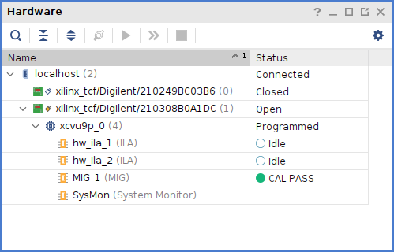

# Flashing the bitstream - VCU118
Use this folder to flash the VCU118 with the bitstream. To make things easier, copy the generated bitstream into the `bitstream` folder.

## Setup
Source the provided setup script to load the correct vivado version:
```
$ source scripts/setup-debug-env.sh # Loads vivado 2022.2
```
## Flashing the board
Run Vivado and open the Hardware manager.
```
$ vivado
```

Open the target using `Auto connect`. Once this finishes, you should see the following:



You should have an open connection with the VCU118 (xilinx_tcf/Digilent/210308B0A1DC). If the open connection is with the other device (xilinx\_tcf/Digilent/210249BC03B6), right-click it and `Close Target`, then rightclick the VCU118 (xilinx_tcf/Digilent/210308B0A1DC) and `Open Target`.

You should now be ready to flash the board.
