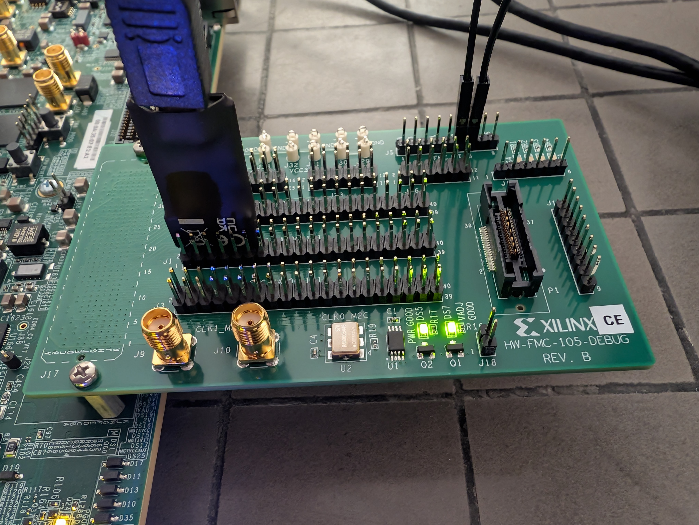
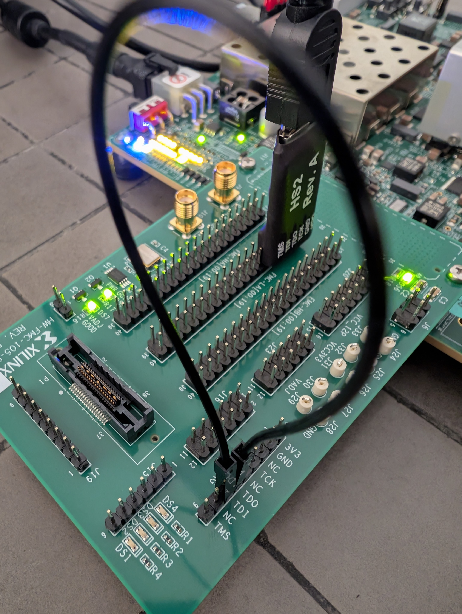
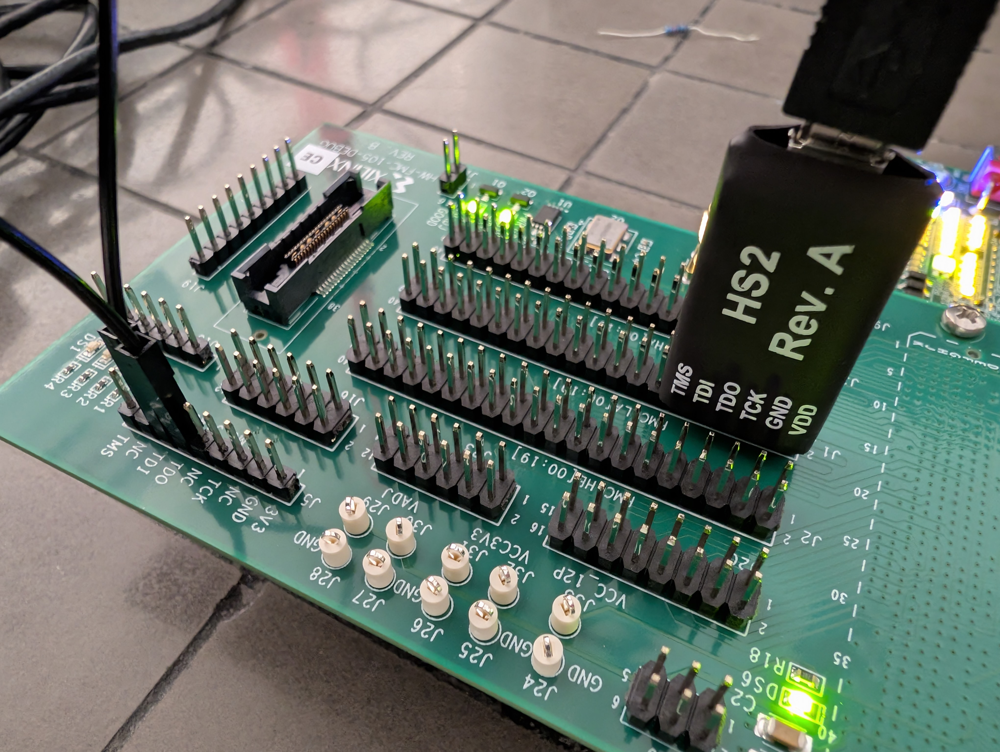

# VCU118 hardware setup

The VCU118 PMOD headers route through on-board level shifters that cause
intermittent JTAG connection issues. Reliable bring-up requires extra
hardware:

 - HW-FMC-105-DEBUG adapter
 - Jumper wire connecting TDI and TDO
 - Digilent HS2 Rev. A debug cable





The VCU118 does not currently support booting from the on-board Quad-SPI
(SD-card) path; programs are loaded over JTAG.

## Build the bitstream

```
make fpga
```

The FPGA top-level is
[`rtl/src/cva6_flexnngine_xilinx.sv`](../rtl/src/cva6_flexnngine_xilinx.sv).
Check that [`fpga/Makefile`](../fpga/Makefile) has `BOARD ?= vcu118`.

## First boot

A minimal `hello_world` example lives in [`../HW_test`](../HW_test). To
produce an ELF for your own program, add an integration test and reuse
the build artifacts.
